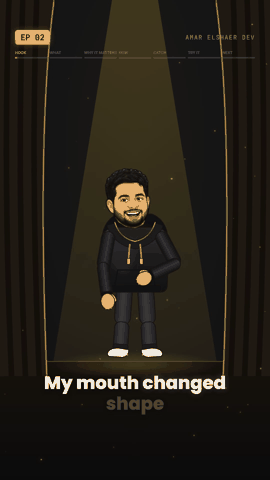

# Remotion Dev Video Kit

**Animated short videos for developers, made with code.** No camera, no editing app.
You write a script; the kit makes the voice (a local clone of *your* voice), times every word,
and renders a 1080×1920 video where a rigged cartoon of you acts out each sentence, lip-synced,
with word-by-word captions, scenes and sound effects.

<p align="center"></p>

Made by **Amar Hassan Elshaer**: [amarhassan.com](https://amarhassan.com) · Instagram & TikTok [@amar_elshaer_dev](https://www.instagram.com/amar_elshaer_dev) · LinkedIn: Amar Hassan Elshaer

> 📘 **Full step-by-step guide (Windows + Mac): [docs/GUIDE.pdf](docs/GUIDE.pdf)**

## What's inside

| Part | Where | What it does |
|---|---|---|
| Rigged character | `src/rig/` | Your cartoon head on a vector body with joints; 15 poses, motions (talk, wave, type, celebrate...), props, real blinks |
| Lip-sync | `src/components/mouth.ts` | ~40 lines: per-frame loudness → mouth open/closed, with hysteresis so it never flickers |
| Scenes | `src/sets/`, `src/scene/` | Stage, code room, desk, sky time-lapse, chalkboard, library, blueprint; items like terminal windows, split-flap stats, kinetic type, counters, stamps, confetti |
| Captions | `src/components/WordCaptions.tsx` | Word-by-word, current word bright, one gold keyword per line |
| Voice | `scripts/tts_qwen.py` | Local, free voice clone with Qwen3-TTS (Apache 2.0) + automatic loudness levelling |
| Timestamps | `scripts/timestamps.py` | faster-whisper word timings |
| Episode builder | `scripts/build_episode.py` | Turns `plan.json` (one scene per sentence) into a validated `episode.json` |
| Character maker | `scripts/make_head.py` | Cuts your closed/open-mouth cartoon into the two head images the rig uses |
| Claude Code skill | `.claude/skills/daily-video/` | The whole workflow: idea → research → proposal → voice → scenes → preview → render → Buffer drafts |
| Project rules | `.claude/CLAUDE.md` | Template with the video rules; fill in your brand |

## Quick start

```bash
# 1. Video side (Node 18+)
npm install
npx remotion studio            # opens the preview; try the RigTest and StyleTest compositions

# 2. Voice side (Python 3.11) - Windows/Linux with an NVIDIA GPU:
py -3.11 -m venv .venv-qwen
.venv-qwen\Scripts\python -m pip install torch==2.6.0 torchaudio==2.6.0 --index-url https://download.pytorch.org/whl/cu124
.venv-qwen\Scripts\python -m pip install -r requirements.txt
#    Mac: see docs/GUIDE.pdf, chapter 2
```

Make an episode:

```bash
# put your 8-15 s voice clip in assets/voice/reference_energy.wav (+ its transcript .txt)
python scripts/tts_qwen.py public/episodes/my-ep/narration.txt
python scripts/timestamps.py public/episodes/my-ep/narration.wav --hint "Remotion, React"
python scripts/build_episode.py public/episodes/my-ep        # needs plan.json, see public/episodes/example
npx remotion render Episode out/my-ep.mp4 --props='{"episodeFile":"episodes/my-ep/episode.json","episode":null}'
```

Or let Claude Code do it: copy `.claude/` into the project, fill in `.claude/CLAUDE.md`, then say
*"make a video about <your idea>"*. It researches, shows you a proposal, waits for your OK, builds,
shows you a preview, and only renders after you approve.

## Before you publish

- **Replace the example character** (`public/character/rig/`) with your own - see the guide, chapter 5.
- **Only clone your own voice**, never someone else's. Your reference clip is git-ignored on purpose.
- Label videos with an AI voice as AI-generated on Instagram and TikTok.

## License

MIT for this kit's code and docs. Remotion, Qwen3-TTS, faster-whisper and the CC0 sounds keep their own licenses - see [LICENSE](LICENSE).
